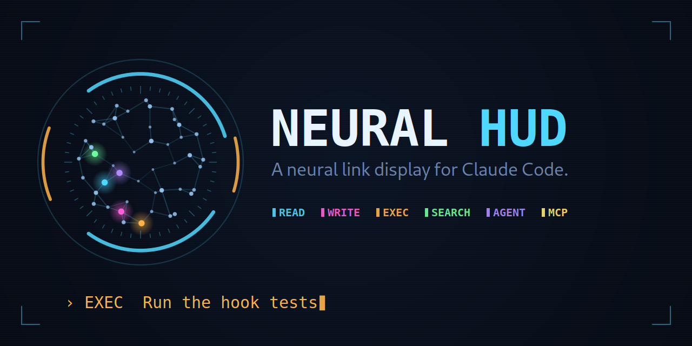
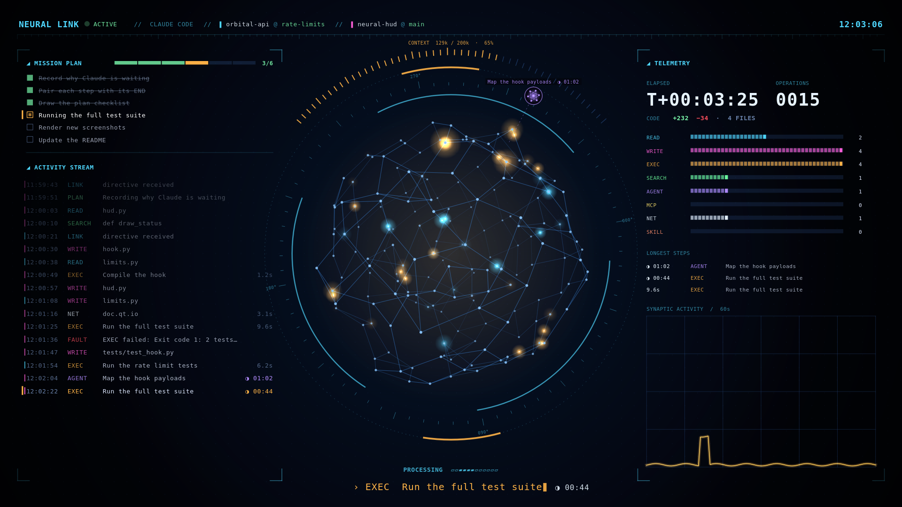
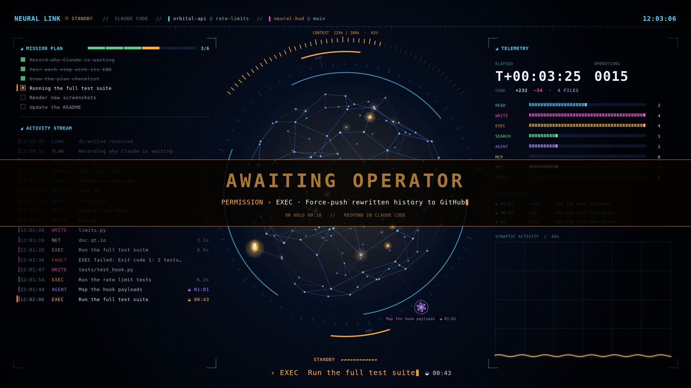
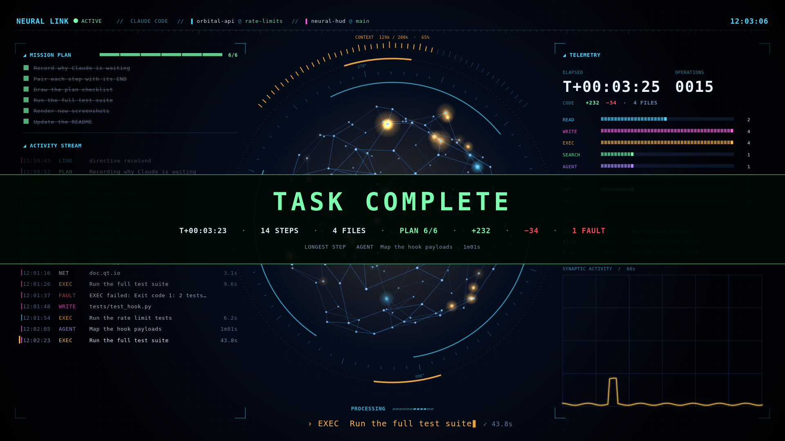
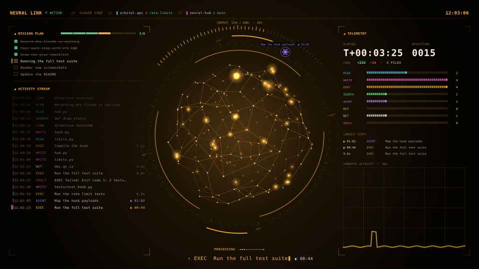
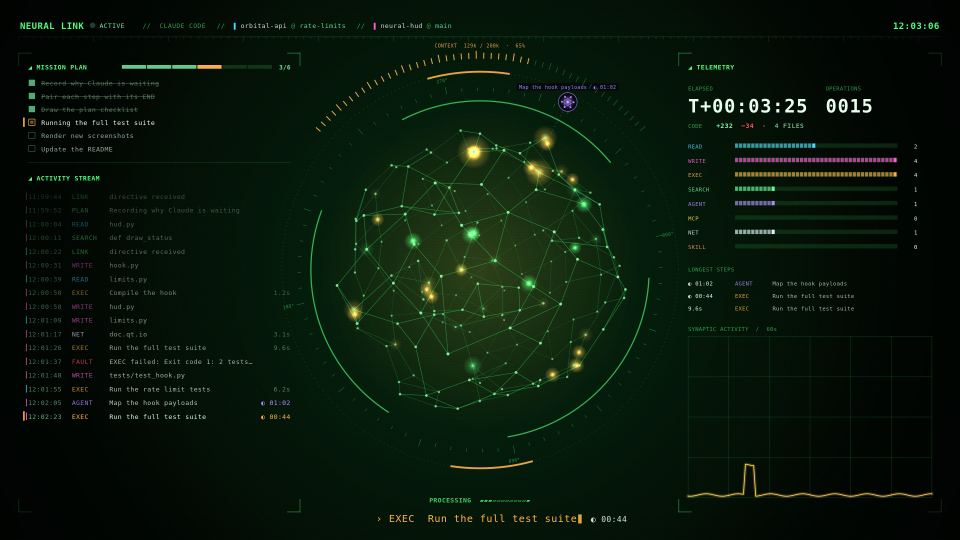
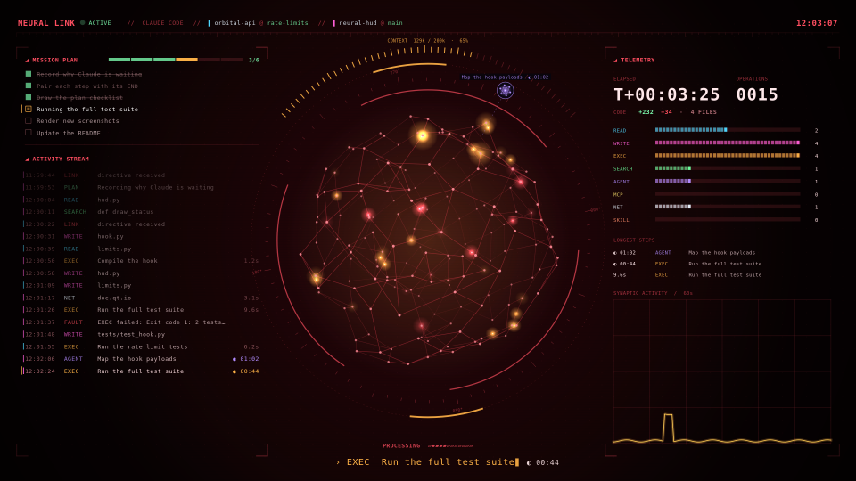
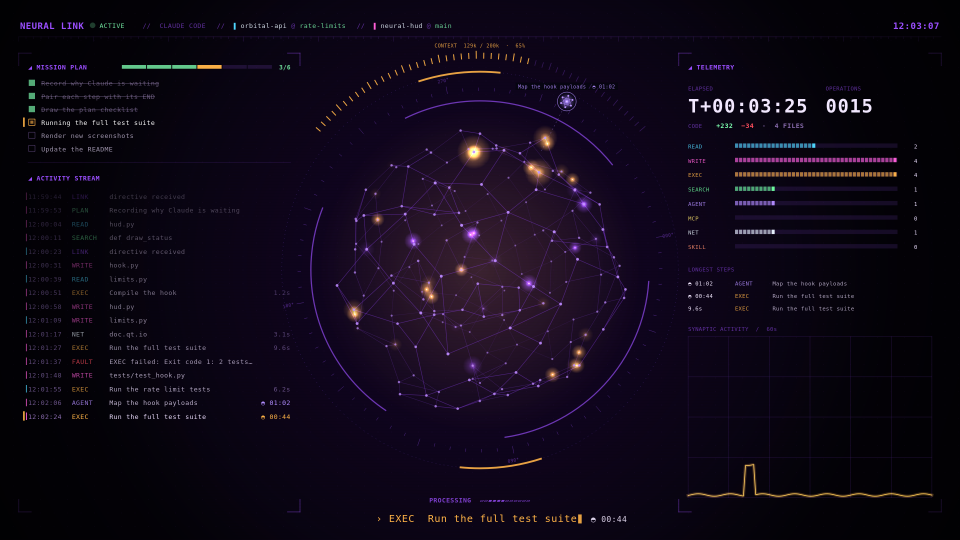

<p align="center">
  
</p>

<p align="center">
  <b>A sci-fi "neural link" display for a spare monitor that comes alive while
  <a href="https://claude.com/claude-code">Claude Code</a> is working, and powers down when it's done.</b><br>
  Signals cascade through a rotating 3D network, colour-coded by what Claude is
  doing, while every step it takes is typed out live.
</p>

<p align="center">
  
  
  
  
  
</p>

---

## The HUD

<p align="center">
  
</p>

<p align="center">
  
  
</p>

<p align="center">
  <sub>Rendered offscreen by <code>tools/screenshot.py</code> from a scripted pair of sessions with the
  real drawing code: mid-task, on hold while Claude waits for a permission, and the end-of-task
  summary. <code>make demo</code> plays the same kind of turn live on your monitor.</sub>
</p>

### Themes

<p align="center">
  
  
  
  
</p>

<p align="center">
  <sub><code>amber</code>, <code>phosphor</code>, <code>red</code> and <code>violet</code>, besides the default
  <code>cyan</code>. A theme re-hues the HUD's chrome; the colours that mean something (what kind of
  step, done, failed, waiting) stay the same in every theme.</sub>
</p>

## Features

- 🧠 **A rotating 3D neural network** in a ring of HUD instruments. Signals cascade through it,
  colour-coded by what Claude is doing: cyan for reading files, magenta for editing, amber for
  running commands, green for searching, violet for subagents, yellow for MCP tools.
- ⌨️ **A live status line** under the core that types out Claude's current step key by key, with
  a blinking block cursor, as if someone were at the terminal, and a live timer once a step
  runs longer than a second.
- ✅ **Mission plan**: when Claude makes a to-do plan, it appears as a checklist above the
  activity stream, ticking steps off as they finish, with the current one highlighted.
- 📜 **Activity stream**: a log of Claude's actual steps as they happen, with how long each took.
- 📈 **Telemetry**: elapsed time, operation count, lines added and removed across how many files,
  a breakdown by kind of action, the longest steps of the turn and an activity trace for the
  last 60 seconds.
- 🛰️ **Subagent satellites**: each running subagent orbits the core as its own small cluster,
  labelled with its task and a timer, and fades out when it reports back.
- 🧪 **Context gauge**: a tick bar over the core shows how full the session's context window is,
  turning amber past 60% and red past 85%.
- 💥 **Failures you can't miss**: a failed step shakes the display and flashes "SIGNAL FAULT" in red.
- 🗂️ **Several sessions at once**: the header shows each session's project and git branch, and
  every step in the stream is marked with its session's colour. A new prompt in one session
  leaves the others' tracks alone.
- 🏁 **End-of-task summary**: before the power-off, a report card counts up the time taken,
  steps, files, lines changed, plan progress and failures, and names the longest step.
- 🎨 **Five colour themes**: cyan, amber, phosphor, red and violet.
- ⏸️ **Stays up when Claude is blocked on you**: an amber "AWAITING OPERATOR" screen says what
  it's waiting for (the command needing approval, or the question it asked) and for how long.
  Time on hold isn't counted in step timings.
- 🔌 **Opens and closes itself**: "LINK ESTABLISHED" when work starts, the summary and a CRT
  power-off when Claude finishes.
- 🫥 **Never gets in the way**: the window takes no keyboard focus and lets every click through, so
  your other screens work normally. An optional keyboard shortcut closes it until your next prompt.
- 🪶 **Light**: runs on the GPU, about 10% of one CPU core at 3072×1728.

## Requirements

- Linux with X11, or Wayland with XWayland (tested on GNOME Wayland)
- Python 3.10+ with PyQt6 (`python3-pyqt6`, or `pip install PyQt6`)
- `xrandr`
- A second monitor (a small USB/portable one is perfect)

## Install

```sh
git clone git@github.com:vanvonvan/NeuralHUD.git
cd NeuralHUD

make monitors                                  # list your screens and their MONITOR= values
make install                                   # uses your smallest non-primary monitor
make install MONITOR=HDMI-1                    # or pick one by xrandr output name
make install MONITOR=ARZOPA                    # or by text in its EDID (usually the brand)
make install THEME=amber                       # cyan (default), amber, phosphor, red, violet
make install CONTEXT=1m                        # the context window the gauge measures against
make install SHORTCUT='<Super><Alt>n'          # GNOME: add a close shortcut
```

The settings combine, e.g. `make install MONITOR=ARZOPA THEME=phosphor`. Try a theme first with
`make demo THEME=red`. Without `CONTEXT`, the gauge assumes a 200k window and switches to 1M
once a session goes past 200k: Claude Code's transcripts don't record the window size, so set
`CONTEXT=1m` if your model has the larger one.

`make install` runs `install.sh`, which copies `hud.py` and `hook.py` to `~/.claude/neural-hud/` and adds hooks to
`~/.claude/settings.json`, after writing a backup to `settings.json.bak-neural-hud`. Your
existing settings and hooks are kept. Running it again replaces the previous install, so
after a `git pull` just run it again.

Close the HUD by hand with `python3 ~/.claude/neural-hud/hud.py --close` (that is what the
shortcut runs). It stays closed until your next prompt.

## Uninstall

```sh
make uninstall
```

This removes the hooks (backing up `settings.json` first) and `~/.claude/neural-hud/`. A GNOME
shortcut added by the installer stays: remove it in **Settings → Keyboard → Custom Shortcuts**.

## How it works

`hook.py` runs (asynchronously) on Claude Code hook events and keeps a little state in
`$XDG_RUNTIME_DIR/claude-neural/`:

| Event | Effect |
|---|---|
| `UserPromptSubmit` | session is *working*; record its project, transcript and turn start; start the HUD if needed |
| `PreToolUse` | log the step to the activity stream |
| `PostToolUse`, `PostToolUseFailure` | session is *working*; log that the step ended, to time it, with the lines an edit added and removed; update the plan after `TodoWrite` / `TaskCreate` / `TaskUpdate` |
| `PermissionRequest`, `Notification` (permission prompt), `AskUserQuestion` | session is *waiting*; record why, for the standby screen |
| `Stop`, `StopFailure`, `SessionEnd` | session is *done* |

`hud.py` shows while any session is working and plays its outro when none is. Several Claude
Code sessions at once are fine. Hooks run asynchronously and can finish out of order, so each
state change carries its hook's start time and an older one never overwrites a newer one.
A session silent for 20 minutes is treated as finished.

Bash steps appear in the stream as their description, never the raw command, and file paths
are shown relative to the project.

The context gauge reads the token usage of the newest message in the session's transcript (the
file Claude Code already writes); the branch comes from the project's `.git/HEAD`. Neither costs
any tokens: nothing here talks to Claude.

## Development

```sh
make demo         # play a scripted ~45 s session live on your monitor (MONITOR= works here too)
make test         # headless: hook events, timing, plan, line counts, sessions, context, themes
make screenshot   # re-render the README screenshots and theme previews offscreen
make art          # regenerate the icon, logo, banner and social preview (needs pycairo)
```

The tests and the screenshot use a private temporary state directory, so they never disturb a
HUD or a Claude Code session running on the same machine.

## Project layout

```
hud.py             the display: a frameless, click-through OpenGL window
hook.py            the Claude Code hook that feeds it
Makefile           install, uninstall and the development tasks
install.sh         copies both to ~/.claude/neural-hud and registers the hooks
uninstall.sh       undoes install.sh
tests/             headless unit tests
tools/             demo, screenshot and art generators
assets/            README and repository art
```

## License

GPL-2.0-or-later — see [LICENSE](LICENSE).

---

Unofficial fan project: not made, endorsed or supported by Anthropic.
